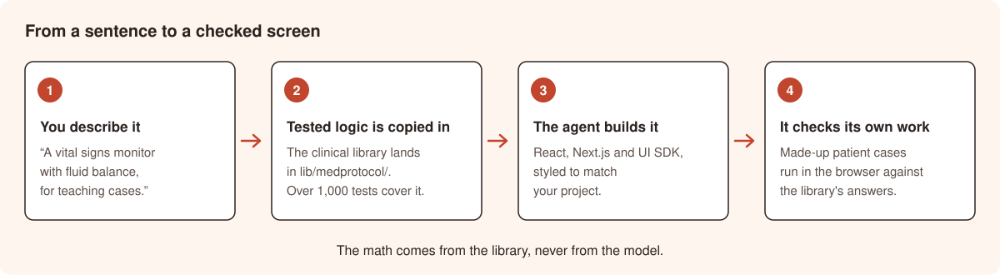
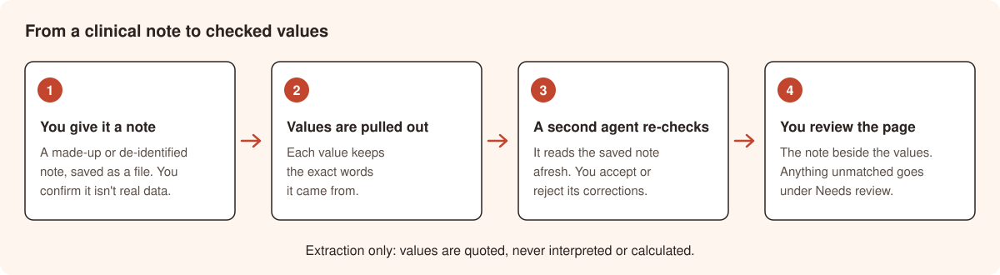
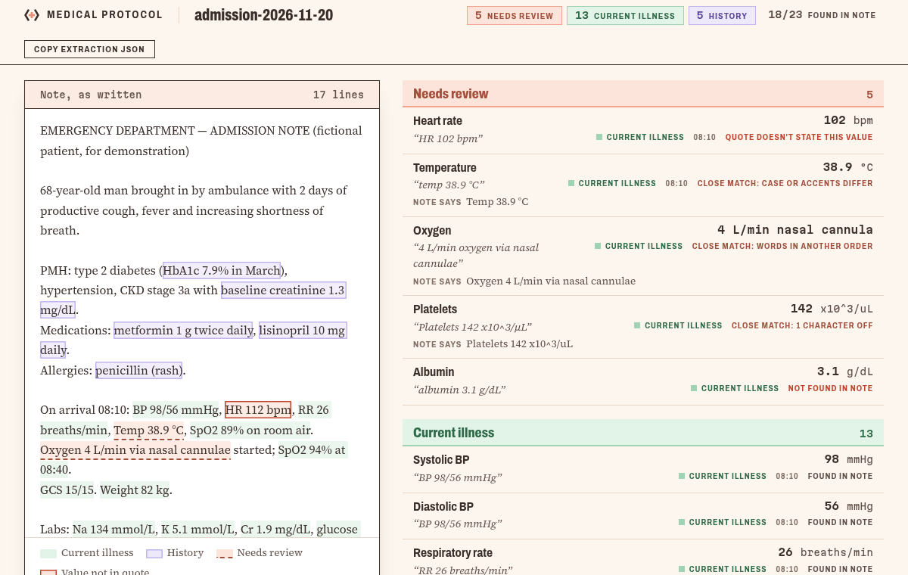

# Medical Protocol

**Clinical skills for Claude Code. For learning and prototyping, not patient care.**

Tell Claude Code what you want in clinical language, and it builds a working screen for you. The numbers on that screen come from a tested clinical library, so the model never does the math. It can also read a clinical note and pull out the values, each with the exact words it came from.



Medical Protocol is open source and made for studying calculations, practising on made-up cases and trying out medical ideas quickly. It is privacy-first: the screens it builds keep what you type on your computer.

## Try saying

- *"I need a vital signs monitor with fluid balance tracking, to practise on teaching cases."*
- *"Build me a DKA tracker with hourly glucose and ketones."*
- *"What's the anion gap for Na 140, Cl 100, HCO3 12?"*
- *"Pull the values out of `notes/admission.md`. It's a made-up note."*

The agent sets up the project, builds the screen and checks it in the browser.

## Medical disclaimer

Medical Protocol is an open-source educational project. It and the tools it generates are for learning, prototyping and experimentation only and must not be used for real patient care, diagnosis or treatment decisions. They are not certified medical devices and do not replace professional clinical judgment. The authors make no warranty about accuracy and accept no liability for any use of this software.

Not for:

- The care of any real patient, now or after the fact (chart review and audit included)
- Real patient notes: use made-up or de-identified notes only, as the note reader asks you to confirm
- Triage, emergencies, alerts, diagnosis or treatment
- Patients, or anyone outside learning and prototyping

Results are worded as teaching: a bedside rule says what its findings point to, never that a condition is ruled out.

## Install

In Claude Code:

```
/plugin marketplace add emdmed/medical-protocol
/plugin install medical-protocol@medical-protocol
```

Then run `/medical-protocol:start` and describe what you need. That's it.

The plugin is the whole install: the skills, the hooks, the clinical library and the calculator all come with it. It needs Node 18 or newer, and nothing is installed from npm for the plugin itself.

To get a newer version, run these in a terminal, then restart Claude Code:

```bash
claude plugin marketplace update medical-protocol
claude plugin update medical-protocol@medical-protocol
```

## Windows

Works on Windows 10 and 11 with Node 18+ and Claude Code with [Git for Windows](https://git-scm.com/downloads/win). Bash commands run in Git Bash. Nothing more is needed.

## How it works

1. **You describe the tool.** The `start` skill sends your request to the right clinical module(s).
2. **The agent copies the clinical logic** from the plugin into your project at `lib/medprotocol/`. It is plain TypeScript with no dependencies, and you don't edit it.
3. **The agent builds the screen** with [UI SDK](https://ui-sdk.dev/docs) (React 19, Next.js, Tailwind), styled to match your project.
4. **The agent checks the screen.** It writes a list of made-up patient cases (`qa/recipes/<module>.md`), gets the expected values from the `medprotocol` CLI, and a small `qa-runner` agent runs the cases in the browser. You can read the cases and add your own in plain clinical words.

The calculations in your app are the same code the tests cover: more than 1,000 of them.

## Reading a clinical note

Ask for a note extraction and you get a page in your browser, served from your own computer. Paste a made-up or de-identified note there. Each value comes back with the exact words it was taken from, a second model run re-checks the first pass, and the page shows the note on one side and the values on the other. Anything that doesn't match the note word for word is flagged for you to review, and you accept or reject each proposed correction with a button.



This is what the page looks like:



The page runs on your computer only (`medprotocol extract --serve`) and can be saved as a local file. It is never published, and the note only reaches the model after you confirm it is not real patient data.

## Point at your app

Already have an app? Run `/medical-protocol:overlay`, then hover over any part of it in the browser. You can audit that part against the protocol, replace it with a medical-protocol screen, or add a new one right there. Changes are staged first and only land when you click Apply.

## What's in the plugin

### Skills

| Skill | Use it to |
|-------|-----------|
| `start` | Describe what you need. Everything starts here. |
| `extract` | Pull the values out of a clinical note, each with the words it came from |
| `extract-page` | Open the extraction page in your browser: paste a note, review the values, accept or reject corrections |
| `cases` | Practise with synthetic worked cases: guess, enter them in your screen, see the answer explained |
| `demo` | Get a prototype ready to show: checked screens, a generated synthetic patient on each, screenshots and a walkthrough in `demo/` |
| `preferences` | Set what you are learning: level, specialty, case population, guidelines and units |
| `protocol-audit` | Audit the prototype for correct results, completeness, synthetic-data use and accessibility |
| `calc-audit` | Test the clinical calculations in your screens against the library |
| `overlay` | Turn on the dev overlay, or process what you selected in it: hover over any part of your app to audit it, replace it with a medical-protocol screen, or add a new one |

Internal skills (called by the agent): `vital-signs`, `acid-base`, `bmi`, `pafi`, `dka`, `water-balance`, `dashboard`, `modify`, `calc`, `qa`, `extract-artifact`, `troubleshoot`, `overlay-setup`, `overlay-audit`, `overlay-implement`, `overlay-add`.

### Hooks

| Hook | When | What it does |
|------|------|--------------|
| `privacy-guard` | Before every shell command | Blocks commands that could send data off the machine (`git push`, `curl` POST, `scp`, `nc`, `npm publish`…) |
| `note-consent` | Before a clinical note is read | Keeps the note from the model until you say it is not real patient data |
| `extraction-guard` | Before every file write | Keeps a saved note and its first extraction from being changed afterwards |
| `track-workflow` | After every shell command | Records build and QA progress |
| `qa-reminder` | When the agent stops | Sends it back to finish the quality checks if a screen was built without them |

### Clinical modules

| Module | What it calculates |
|--------|-------------------|
| **Vital Signs** | BP, HR, RR, SpO2, temperature: validated ranges, severity alerts, FHIR R4 output |
| **Acid-Base** | Primary disorder, compensation (Winter's), anion gap, delta ratio |
| **BMI** | WHO classification |
| **Water Balance** | Insensible losses, endogenous water, net fluid balance |
| **PaFi (ARDS)** | PaO2/FiO2 ratio with Berlin severity |
| **DKA** | Hourly glucose/ketone/HCO3 rates, resolution criteria, cerebral edema warnings |
| **Cardiology** | ASCVD 10-year risk, HEART score, CHA₂DS₂-VASc |
| **Sepsis** | qSOFA, SOFA-2 (6 organs), lactate clearance, hour-1 bundle |
| **CKD** | eGFR (CKD-EPI 2021), KDIGO staging, KFRE 2/5-year risk, treatment criteria, anemia, CKD-MBD |
| **Diabetes** | ADA 2026 diagnosis, T1D staging, T1 vs T2, T2D screening, gestational diabetes |

## The `medprotocol` CLI

The same clinical library, from the terminal. It ships inside the plugin as one Node script (`plugin/scripts/medprotocol.cjs`), and the skills run it with `node`. The QA step uses it as the source of expected values. Below, `medprotocol` stands for `node plugin/scripts/medprotocol.cjs`.

```bash
medprotocol abg --ph 7.25 --pco2 30 --hco3 12
```

```
ABG Analysis
────────────
  Disorder        Metabolic Acidosis
  Compensation    Inadequate compensation
  Interpretation  Primary Metabolic Acidosis, with Inadequate compensation and Respiratory Acidosis.
  Expected range  24.0–28.0
  Additional      Respiratory Acidosis
```

```bash
medprotocol sepsis qsofa --rr 24 --sbp 90 --gcs 13
```

```
Quick SOFA (qSOFA)
──────────────────
  Score             3/3
  Positive          Yes
  Respiratory Rate  24
  Systolic BP       90 mmHg
  GCS               13
```

Commands: `bmi`, `abg`, `vitals`, `pafi`, `dka`, `water-balance`, `cardiology`, `sepsis`, `shock`, `ckd`, `diabetes`, `extract`, `overlay`. Add `--json` to any command, `--help` for its options. `medprotocol extract --serve` starts the local extraction page (`--port <number>` to change the port).

## Repository layout

```
plugin/                    # The Claude Code plugin
├── .claude-plugin/        # plugin.json
├── skills/                # SKILL.md + reference/ per skill
├── agents/                # qa-runner (browser QA), extraction-verifier
├── scripts/medprotocol.cjs # Built CLI
├── hooks/                 # privacy-guard, note-consent, extraction-guard, track-workflow, qa-reminder
└── lib/                   # Clinical logic (copied into user projects)
public/medical-protocol/   # Source of the shared docs: build contract, routing, per-module specs, workflows
packages/medprotocol/      # CLI source
scripts/                   # Version bump; sync of the shared docs into plugin/skills (part of `npm run build`)
tests/                     # Vitest, clinical logic only
```

This repo has no UI code. Screens are generated in each user's project. See `CLAUDE.md` for details.

## Contributing

Contributions are welcome, especially new clinical modules and corrections from clinicians.

1. Fork and create a feature branch
2. Add tests in `tests/` for any new clinical logic
3. Make sure all tests pass. If you changed the CLI, `plugin/lib/` or `public/medical-protocol/`, rebuild (`npm run build`) and commit the result
4. Open a PR

New clinical module: follow `.patterns/new-module/new-module.md` (logic in `plugin/lib/`, tests, context doc, CLI command, skill, classification row).

## License

See [LICENSE](./LICENSE).
